# badger

My mods for the **GitHub Universe '26** badge (Badger 2350: RP2350, 320×240 colour screen, MonaOS 4.0, MicroPython).

<p align="center">
  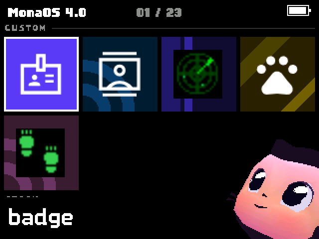
  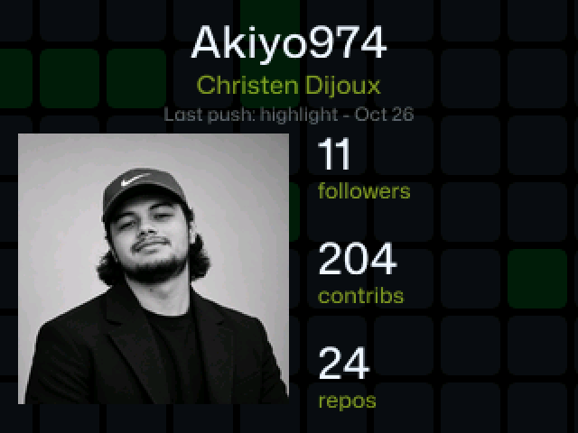
</p>

## Gallery

Screenshots taken straight from the badge with `tools/screenshot.ps1`.

### Apps changed in this repo

| Badge | Badge: QR codes | Badge: NFC scan |
|---|---|---|
|  |  | 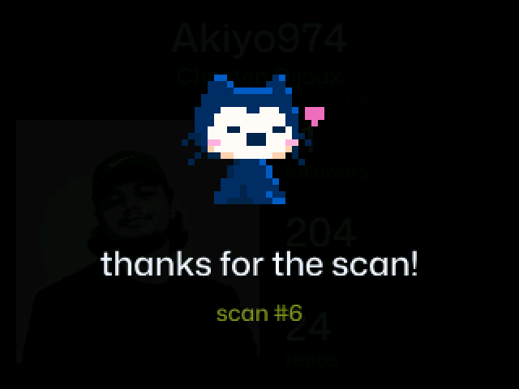 |
| **Contacts** | **Radar** | **Radar: list** |
| 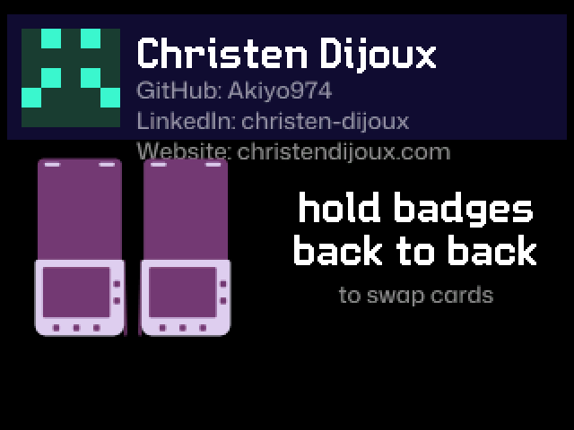 | 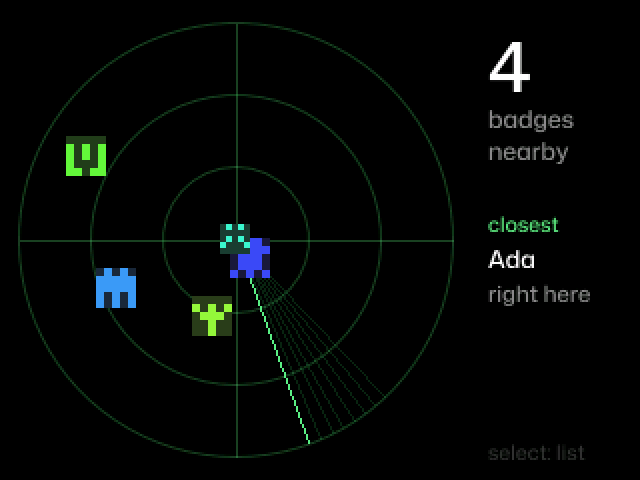 | 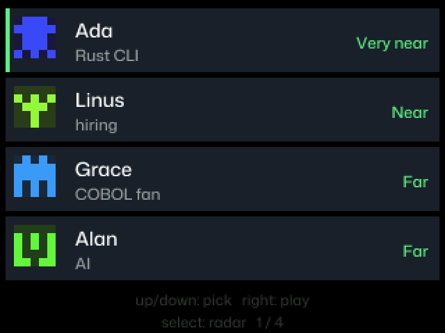 |

| Radar: Hot / Cold game | Radar: encounter history |
|---|---|
| 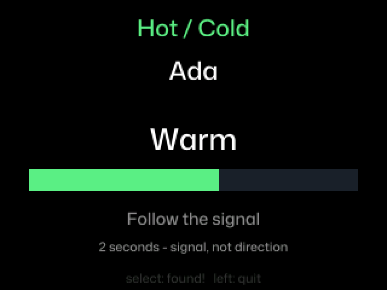 | 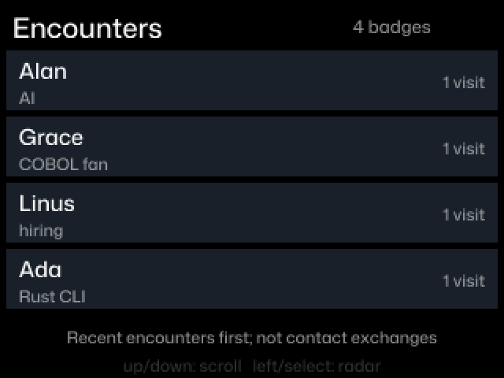 |

The badges on the Radar screenshots are simulated (I only have one badge).

### Stock apps

| Menu | Snake | Pong |
|---|---|---|
|  | 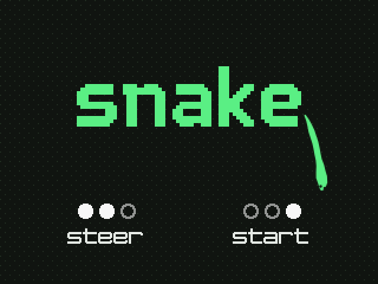 | 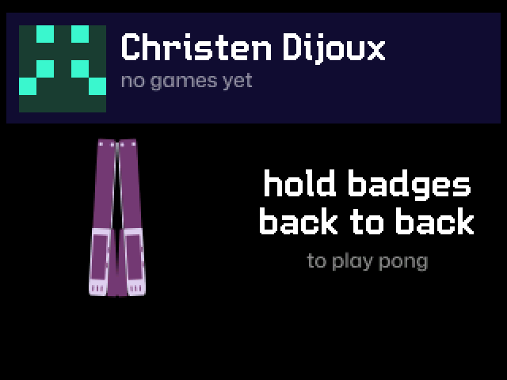 |
| **Merge Conflict** | **Flappy Mona** | **Mona Pet** |
|  |  | 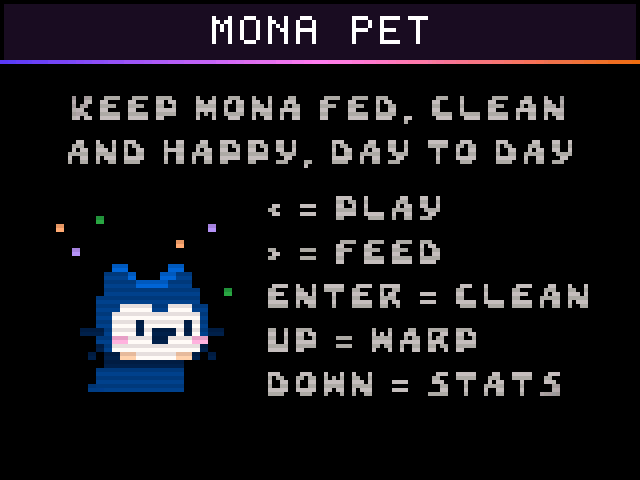 |
| **Mona Paint** | **Rogue** | **Brattal** |
| 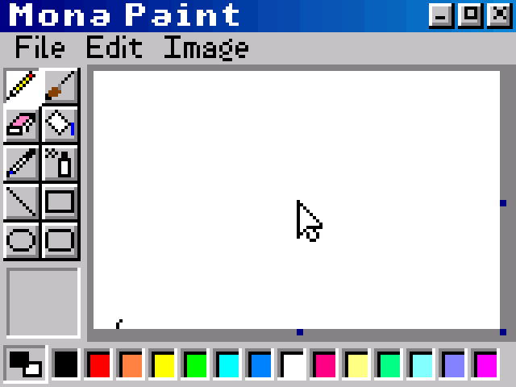 | 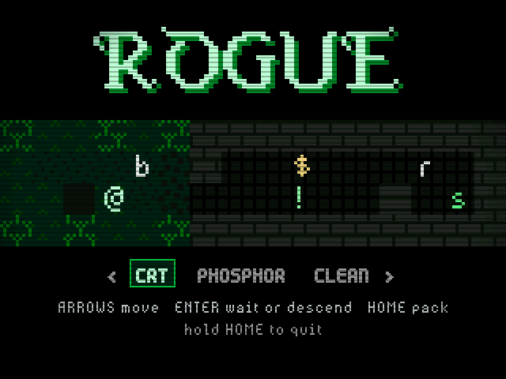 | 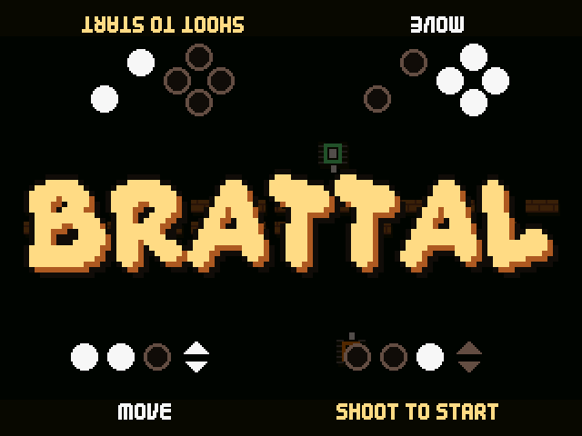 |
| **Life** | **ISS** | |
| 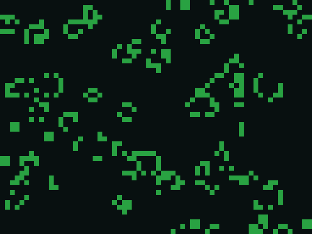 | 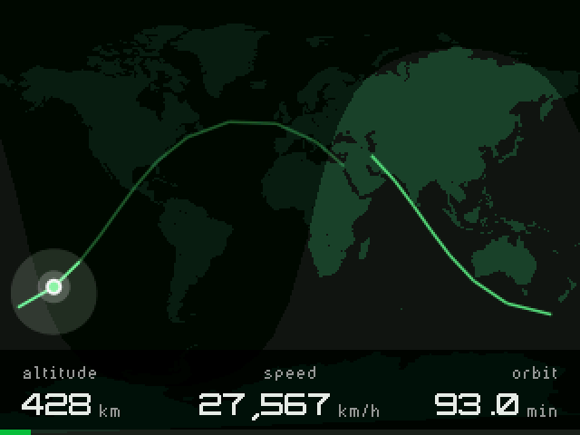 | |

## What's inside

| Folder | Purpose |
|---|---|
| `system/` | Exact copy of the badge's USB drive (`/system` on the device): `main.py`, the boot animation, apps and assets |
| `tools/` | PC scripts: deploy, screenshots, contacts export, QR codes |
| `tests/` | Simulated tests run in CI: Contacts compatibility with stock badges, Radar behaviour |
| `wear/` | **Badger Remote**, the Wear OS watch app that presses the badge's buttons (Kotlin, Compose for Wear OS) |
| `docs/screenshots/` | README screenshots and their list (`captures.json`) |
| `secrets.example.py` | Settings template; the real `secrets.py` is never committed |
| `CHANGELOG.md` | Change history |

The stock badge software in `system/` (MonaOS and its apps) belongs to its authors and is included here so the changes can be read and deployed. Fonts are under the SIL Open Font License (`system/assets/fonts/licences/OFL.txt`).

## Deploying to the badge

Plug the badge in over USB, then from the repo root:

```powershell
./tools/deploy.ps1
```

The script:
1. finds the badge (serial port and **BADGER** drive) and switches it to USB drive mode if needed;
2. copies only the files whose **content** changed (dates don't count, git changes them on every checkout);
3. never touches `secrets.py` and never deletes anything on the badge;
4. reboots the badge into normal mode.

| Option | Effect |
|---|---|
| `-DryRun` | Lists the files that would be copied, without writing anything |
| `-Only apps/badge` | Deploys only one folder of `system/` |
| `-NoReboot` | Leaves the badge in USB drive mode after copying |
| `-Port COM4` | Forces the serial port if detection fails |

To try a pull request: `git checkout <branch>` then `./tools/deploy.ps1`.

### By hand

1. Put the badge in USB drive mode (**Mass Storage** app, or double-tap RESET).
2. Copy the contents of `system/` to the **BADGER** drive.
3. Eject the drive, then restart the badge.

## Apps added or changed

| App | What changes |
|---|---|
| **Badge** | QR code pages (↑ / ↓), a "Last push" line under the name, contribution graph on an LED matrix, NFC contact card and a reaction when a phone scans it |
| **Contacts** | Received links are checked, website field, delete a contact, export to the PC |
| **Radar** (new) | Nearby badges with signal-based proximity, fading, encounter history and an opt-in Hot / Cold game; optional matrix and haptic feedback |
| **Menu** | Shows an app's `icon.png` when it has no built-in icon (Radar ships one; Badge keeps its built-in icon) |

### Radar

- **Proximity, not distance**: labelled rings show **Very near / Near / Far**, based on smoothed Bluetooth signal strength, never metres. Angles are fixed spots derived from badge IDs, not directions.
- **Visible badges**: every badge running Radar, and stock badges while they are in Contacts, Pong or Merge Conflict (their Bluetooth only advertises then).
- **Your status**: `RADAR_STATUS` in `secrets.py`, shared with other Radar badges (name + status: 25 bytes in total).
- **Select** switches between the radar and the list; **↑ / ↓** chooses a badge. Badges fade after 4 seconds without a signal and disappear after 12 seconds.
- **Hot / Cold game**: from the list, **Right** starts a game for the selected badge, with a gauge, case lights and optional vibration. **Select** manually confirms **Found!**; **Left** quits. Normal radar remains the default.
- **Encounter history**: **Right** on the radar opens the 200 most recent distinct badges, saved across restarts in `/state/radar_history.json`, with their names, status and visit counts. Detections are not contact exchanges.
- Only badges are shown, never phones or other Bluetooth devices.
- Repeated announcements are coalesced and unrelated traffic is filtered before the detection queue. See [Radar's controls and behavior](system/apps/radar/README.md).

## Built-in sensors

Besides its buttons, the badge has a motion sensor, a light sensor and battery monitoring. The values below were read on my badge over the serial console; MicroPython apps reach them through the global `badge` object. Call `badge.update()` once per frame (`run()` does it for you), so readings and events stay fresh.

| Sensor | Call | What it returns |
|---|---|---|
| Motion (LSM6DS3 accelerometer + gyroscope) | `badge.imu()` | `(ax, ay, az, gx, gy, gz)`, raw signed 16-bit values. Accelerometer range is ±2 g, so **16384 ≈ 1 g**: flat on a table it reads about `(0, 0, -16384, …)`. The gyroscope saturates at ±32767 when shaken hard. |
| Motion events | `badge.imu_event()` | A tuple of the events detected since the last frame, empty most of the time (see below). |
| Orientation | `badge.imu_upright()`, `badge.upside_down()` | The calibrated "upright" gravity vector, e.g. `(0, 16384, 0)`, and whether the badge is held upside down. The firmware also has `badge.autorotate()` and `badge.rotate_180()` to turn the screen around. |
| Ambient light | `badge.light_level()` | A raw integer, from **0** with the sensor covered to about **670** under a phone flashlight; about 540 in a lit room. |
| Buttons as "touch" | `badge.touch()`, `badge.touch_map()` | The indexes (0–7) of the buttons currently held, and the map from index to button pin (index 4 is `BUTTON_MENU`, 7 is `BUTTON_BACK`). This board has no capacitive touch channels, so "touch" means the buttons. |
| Battery | `badge.battery_level()`, `badge.is_charging()`, `badge.usb_connected()` | Percentage (e.g. `96`), charging and USB states. |

### Motion events

Event codes come from the firmware's `lsm6ds3` driver (`EVENT_*` constants) and can arrive together, e.g. `(8, 16)`:

| Code | Event | What triggered it in my tests |
|---|---|---|
| `1` | Single tap | Tapping the screen or the case |
| `2` | Double tap | Two quick taps, often reported right after a `1` |
| `4` | Free fall | Not seen (I did not drop the badge) |
| `8` | Tilt | Tilting the badge or turning it over |
| `16` | Significant motion | Shaking |
| `32` | *(no constant in the driver)* | Turning the badge upside down, at the same moment `upside_down()` became `True` |

The driver can also count steps (`get_step_count()` on the `lsm6ds3.LSM6DS3` object), but no app uses it.

```python
# Inside an app's update(), with run(update) calling badge.update() each frame
for event in badge.imu_event():
    if event == 2:        # double tap
        open_contact_card()
    elif event == 16:     # shake
        start_radar()

ax, ay, az = badge.imu()[:3]
tilt_left = ax < -6000    # roughly 20° of tilt
dark = badge.light_level() < 50
```

Already used by the stock software: the menu and the Badge app shift their tiles and graph with the motion sensor (a small parallax effect when you tilt the badge).

## Hardware add-ons (Qw/ST port)

The badge has a Qw/ST (Qwiic / STEMMA QT) I²C connector. Badge and Radar look for these boards when they start; each one is optional and can be plugged in or out between launches. Without them, the apps work as before.

| Board | I²C address | Used by | What it does |
|---|---|---|---|
| 13×9 RGB LED matrix (IS31FL3741) | `0x30` | Badge, Radar | **Badge**: the last 13 weeks of the contribution graph in green, plus the weekly total on the bottom row; a blue dot sweeps the top row while loading, amber means missing settings, red a connection error. **Radar**: a small radar with the sweep and the nearby badges, coloured by app (blue Radar, yellow Contacts, orange Pong); fading badges dim, and during Hot / Cold only the selected badge is shown. |
| NFC tag (Adafruit ST25DV) | `0x53` (+ `0x57`) | Badge | Holds a **contact card**: a phone held near the antenna offers to add the contact (name, title, company, labelled Website / LinkedIn / GitHub links), with the website link as a fallback. While Badge is open, a **scan is detected**: Mona appears with hearts and "thanks for the scan!", a heart pulses on the matrix, the motor buzzes and a scan counter goes up. The tag must be NDEF-formatted; any data already on it is replaced. |
| Haptic driver (DRV2605 or DRV2605L) + ERM motor | `0x5A` | Radar, Badge | **Radar**: a short vibration for new arrivals (simultaneous ones are merged); during Hot / Cold, pulses that speed up as the target gets closer. **Badge**: a buzz on each NFC scan. |

- The matrix runs at a limited global current (`0x40`), and its previous registers are restored when the app exits.
- Each app checks the chip id before using a board, and prints what it found in the serial console (e.g. `Radar matrix: IS31FL3741 at 0x30, 13x9 RGB`).
- To see what is plugged in: `import machine; print([hex(a) for a in machine.I2C().scan()])` in the console (`0x2d` is the badge's own hardware).

## Watch remote (Wear OS)

**Badger Remote** (`wear/`) turns a Wear OS watch (Galaxy Watch 4 or newer) into the badge's buttons: ↑ ↓ ← →, Select, Back and Home, in every app, menu included.

<p align="center">
  <a href="docs/media/badger-remote.mp4">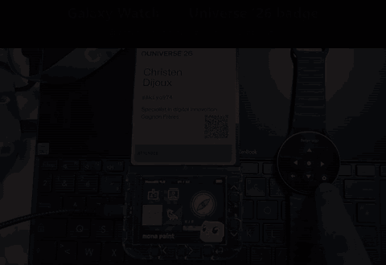</a>
</p>
<p align="center"><sub>Click for the video (MP4).</sub></p>

- **Tap** a button for a short press; **keep your finger on it** to hold it (e.g. zooming in ISS). The **crown** scrolls like ↑ / ↓.
- The top line shows the badge's name (`Badger` + the end of its id). The watch remembers that badge; tap the name to pick another one.
- **How it works**: `system/remote.py`, started by `main.py`, advertises a Bluetooth LE service with one writable characteristic. Each write is 2 bytes, an action (0 tap, 1 down, 2 up) then a button (0 ↑, 1 ↓, 2 ←, 3 →, 4 Select, 5 Back, 6 Home). The presses are merged into `badge.poll()`, so apps see them as real presses. A held button is released after 1.5 s without news from the watch.
- **Not available** in Contacts, Pong, Merge Conflict and Radar: they need the badge's Bluetooth. The watch reconnects on its own once you leave them (the badge reboots after every app).
- **No pairing**: any phone or watch running the app nearby can press your buttons while the remote is on. `WATCH_REMOTE = False` in `secrets.py` turns it off.

### Installing on the watch

1. Download the APK: the **badger-remote-debug** artifact of the latest [CI run](https://github.com/Akiyo974/badger/actions/workflows/ci.yml) (a zip containing `app-debug.apk`), or a `wear-v*` release.
2. On the watch: **Settings → Developer options**, turn on **ADB debugging** and **Wireless debugging** (the watch and the PC must be on the same Wi-Fi). Developer options appear after tapping **Settings → About watch → Software information → Software version** 7 times.
3. In **Wireless debugging**, tap **Pair new device**: the watch shows a pairing code and an `IP:port`. On the PC:

   ```powershell
   adb pair 192.168.1.42:37000      # IP:port of the pairing screen, then type the code
   adb connect 192.168.1.42:41000   # IP:port shown at the top of Wireless debugging (not the same port)
   adb install -r app-debug.apk
   ```

4. Open **Badger Remote** on the watch and allow **Nearby devices**. Switch the badge on: the name appears at the top and the buttons light up.

Each CI run signs its debug APK with a different key: if `adb install` answers `INSTALL_FAILED_UPDATE_INCOMPATIBLE`, run `adb uninstall com.christendijoux.badgerremote` first. Signed releases (`wear-v*` tags) keep the same key and update in place.

### Building it yourself

From `wear/`, with JDK 17 and the Android SDK: `./gradlew assembleDebug`, then `adb install -r app/build/outputs/apk/debug/app-debug.apk`.

## Screenshots

```powershell
./tools/screenshot.ps1                       # retakes every screenshot in docs/screenshots/
./tools/screenshot.ps1 -App snake -Seconds 5 # a single app
```

The script starts the app over the serial console, lets it run for a few seconds, reads the screen buffer (RGB565, 320×240 or 160×120) and saves it as a PNG scaled ×2. The list of screenshots and their settings (`setup`, e.g. to open a page or simulate badges) lives in `docs/screenshots/captures.json`. Allow about 25 s per screenshot.

After changing an app: `./tools/deploy.ps1`, then `./tools/screenshot.ps1`.

## Exporting contacts

```powershell
./tools/export_contacts.ps1 -OutDir ~/Desktop
```

Reads the cards swapped with the **Contacts** app (in `/state`, outside the USB drive) and writes `contacts.csv` and `contacts.vcf`, ready to import into a phone, Outlook or Google Contacts.

## Tests

```powershell
py tests/test_contacts_compat.py
py tests/test_radar.py
```

Simulates card swaps between the stock Contacts app (read from the first commit) and the version in this repo, to check that swapping with an unmodified badge still works.

The Radar tests simulate BLE traffic, proximity/fading, the opt-in game and persistent encounter history without requiring hardware.

GitHub Actions (`.github/workflows/ci.yml`) runs these tests, checks the syntax of `system/`, and builds, tests and lints the watch app on every pull request. Pushing a `wear-v*` tag publishes a signed APK (`wear-release.yml`, needs the `SIGNING_KEYSTORE_BASE64`, `SIGNING_PASSWORD` and `SIGNING_KEY_ALIAS` secrets).

## Settings

Use the badge's **Settings** app, or copy `secrets.example.py` to `secrets.py` on the drive and fill it in.

## How I work

- `main` is always deployable.
- Every change goes through a branch (`feat/…`, `fix/…`) and a pull request, tested on the badge with `deploy.ps1` and reviewed by Copilot before merging.
- Every PR adds its line to `CHANGELOG.md`, under "Unreleased".

## Good to know

- `/system` is read-only for the badge itself: it is only changed through the USB drive.
- Caches and saves (GitHub stats, achievements, contacts…) live in `/state`, outside the USB drive.
- MicroPython console on the badge's serial port (115200 baud), e.g. with Thonny.
