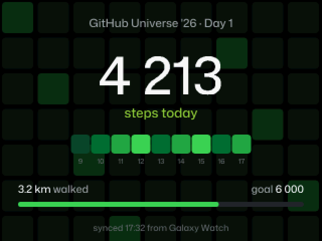
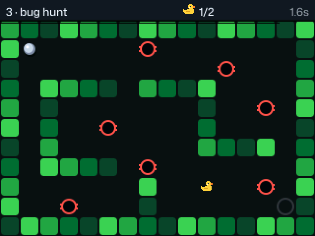
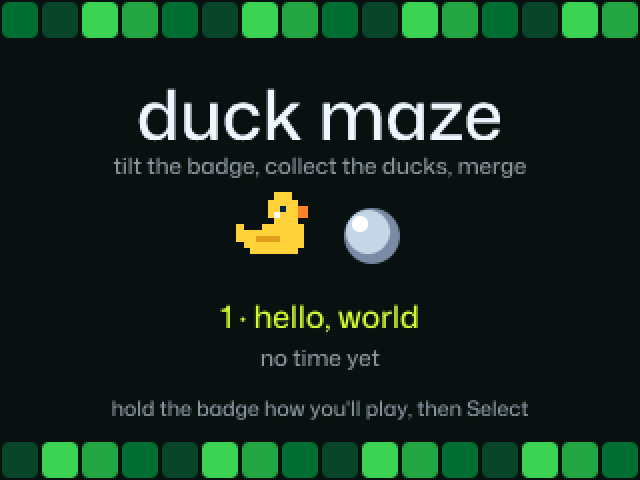

# badger

My mods for the **GitHub Universe '26** badge (Badger 2350: RP2350, 320×240 colour screen, MonaOS 4.0, MicroPython), and **[Badge Studio](https://akiyo974.github.io/badger/)**, an app store for the badge that runs in the browser. Contributions welcome: [make your first app in 10 minutes](CONTRIBUTING.md#make-your-first-app-in-10-minutes).

[](https://github.com/Akiyo974/badger/actions/workflows/ci.yml)
[](https://akiyo974.github.io/badger/studio/)
[](LICENSE)
[](https://github.com/Akiyo974/badger/labels/good%20first%20issue)

<p align="center">
  
  
</p>

## Gallery

Screenshots taken straight from the badge with `tools/screenshot.ps1`.

### Apps changed in this repo

| Badge | Badge: QR codes | Badge: NFC scan |
|---|---|---|
|  |  |  |
| **Contacts** | **Radar** | **Radar: list** |
|  |  |  |

| Radar: Hot / Cold game | Radar: encounter history | Pedometer |
|---|---|---|
|  |  |  |
| **Mona Pet** | **Menu: CUSTOM first** | **Duck Maze** |
|  |  |  |
| **Menu: shake the badge** | | |
|  | | |

The badges on the Radar screenshots are simulated (I only have one badge), and so are the steps on the Pedometer one.

### Stock apps

| Snake | Pong | Merge Conflict |
|---|---|---|
|  |  |  |
| **Flappy Mona** | **Mona Paint** | **Rogue** |
|  |  |  |
| **Brattal** | **Life** | **ISS** |
|  |  |  |

## What's inside

| Folder | Purpose |
|---|---|
| `system/` | Exact copy of the badge's USB drive (`/system` on the device): `main.py`, the boot animation, apps and assets |
| `tools/` | PC scripts: deploy, screenshots, new app, contacts export, art and promo images |
| `templates/app/` | Starting point of a new app, copied by `tools/new_app.py` |
| `tests/` | Tests run in CI: app checks, Contacts compatibility with stock badges, Radar behaviour, Duck Maze levels, watch steps |
| `wear/` | **Badger Remote**, the Wear OS watch app that presses the badge's buttons (Kotlin, Compose for Wear OS) |
| `docs/` | GitHub Pages site and **Badge Studio** (`docs/studio/`), README screenshots and their list (`docs/screenshots/captures.json`) |
| `secrets.example.py` | Settings template; the real `secrets.py` is never committed |
| `CHANGELOG.md` | Change history |
| `CREDITS.md`, `SECURITY.md`, `PRIVACY.md` | Who made what and licenses, how to report a security issue, what the badge and the site share |

The stock badge software in `system/` (MonaOS and its apps) belongs to its authors and is included here so the changes can be read and deployed. Fonts are under the SIL Open Font License (`system/assets/fonts/licences/OFL.txt`).

## Deploying to the badge

Plug the badge in over USB, then from the repo root:

```powershell
./tools/deploy.ps1
```

The script:
1. finds the badge (serial port and **BADGER** drive) and switches it to USB drive mode if needed;
2. copies only the files whose **content** changed (dates don't count, git changes them on every checkout);
3. never touches `secrets.py` and never deletes anything on the badge;
4. reboots the badge into normal mode.

| Option | Effect |
|---|---|
| `-DryRun` | Lists the files that would be copied, without writing anything |
| `-Only apps/badge` | Deploys only one folder of `system/` |
| `-NoReboot` | Leaves the badge in USB drive mode after copying |
| `-Port COM4` | Forces the serial port if detection fails |

To try a pull request: `git checkout <branch>` then `./tools/deploy.ps1`.

### From the browser: Badge Studio

**[akiyo974.github.io/badger/studio](https://akiyo974.github.io/badger/studio/)**, in Chrome or Edge on a computer (Web Serial). The [home page](https://akiyo974.github.io/badger/) lists every app of the store; a [20-second video](docs/media/badge-studio.mp4) shows it. Plug the badge in, press **Connect badge**:

| Tab | What it does |
|---|---|
| **Apps** | Store of the official badge apps ([badger/home](https://github.com/badger/home)) and of this repo: install, update, reinstall, uninstall, details with the README. Apps go to the writable `/apps` folder (the badge cannot write to `/system`); every file is checked (size and CRC) after it is written |
| **Home screen** | Drag the apps into the order you want, choose the ones under **CUSTOM**, hide the others. Saved in `/state/menu_layout.json` |
| **Extensions** | Compares the built-in apps with the versions in this repo and installs the ones you want: the badge switches to USB drive mode, you pick the drive's `apps` folder once, and every app replaced is **backed up** in `apps/.studio-backups` first, with a Restore button |
| **Repair** | Compares the whole BADGER drive with a healthy copy and puts back the missing or different files. See [Repairing the badge](#repairing-the-badge) |
| **Settings** | Wi-Fi, GitHub name, contact card, NFC, Radar status, steps goal, watch remote. Saved through the firmware's own `secrets` module; the Wi-Fi password is never shown |
| **Screenshot** | The screen, or any app after a few seconds, as a PNG |
| **Console** | The MicroPython REPL |

The official site [badger.github.io](https://badger.github.io) has its own app store, which writes to the badge's USB drive, and a [simulator](https://badger.github.io/editor) to try code without a badge. Badge Studio works over the serial port instead, without switching modes, and adds the settings, screenshots, the home screen order, backups and apps from any repository.

If GitHub's API rate limit is reached (60 calls an hour per IP address, shared on a conference Wi-Fi), the store falls back to `docs/catalog.json`, a copy of the app list that `tools/make_catalog.py` refreshes every hour (`.github/workflows/catalog.yml`).

The menu of this repo is needed for the installed apps to show up (under an **INSTALLED** band) and for the home screen layout: on a stock badge, install the **Menu** extension first. The page itself is in `docs/studio/` and runs locally with `py -m http.server 8765 --directory docs`.

### By hand

1. Put the badge in USB drive mode (**Mass Storage** app, or double-tap RESET).
2. Copy the contents of `system/` to the **BADGER** drive.
3. Eject the drive, then restart the badge.

## Apps added or changed

| App | What changes |
|---|---|
| **Badge** | QR code pages (↑ / ↓), a "Last push" line under the name, contribution graph on an LED matrix, NFC contact card and a reaction when a phone scans it |
| **Contacts** | Received links are checked, website field, delete a contact, export to the PC |
| **Radar** (new) | Nearby badges with signal-based proximity, fading, encounter history and an opt-in Hot / Cold game; optional matrix and haptic feedback |
| **Pedometer** (new) | The day's steps from the watch, hour by hour, distance and a 6,000-step goal |
| **Duck Maze** (new) | Tilt the badge to roll a marble through 6 mazes: collect the rubber ducks, avoid the bug holes, reach the merge |
| **Mona Pet** | Steps from the watch feed Mona (500 steps = 1 meal) and lift her mood; Down shows her walk |
| **Menu** | Shows an app's `icon.png` when it has no built-in icon (Radar ships one; Badge keeps its built-in icon); the apps this repo changed come first, under a **CUSTOM** band, then the stock ones under **STOCK**. Apps installed from Badge Studio (`/apps`) show up under **INSTALLED**, and the order, the CUSTOM apps and the hidden ones can be changed from Badge Studio. **Shake the badge** and Mona gets dizzy: X eyes, rubber ducks circling her head |

### Radar

- **Proximity, not distance**: labelled rings show **Very near / Near / Far**, based on smoothed Bluetooth signal strength, never metres. Angles are fixed spots derived from badge IDs, not directions.
- **Visible badges**: every badge running Radar, and stock badges while they are in Contacts, Pong or Merge Conflict (their Bluetooth only advertises then).
- **Your status**: `RADAR_STATUS` in `secrets.py`, shared with other Radar badges (name + status: 25 bytes in total).
- **Select** switches between the radar and the list; **↑ / ↓** chooses a badge. Badges fade after 4 seconds without a signal and disappear after 12 seconds.
- **Hot / Cold game**: from the list, **Right** starts a game for the selected badge, with a gauge, case lights and optional vibration. **Select** manually confirms **Found!**; **Left** quits. Normal radar remains the default.
- **Encounter history**: **Right** on the radar opens the 200 most recent distinct badges, saved across restarts in `/state/radar_history.json`, with their names, status and visit counts. Detections are not contact exchanges.
- Only badges are shown, never phones or other Bluetooth devices.
- Repeated announcements are coalesced and unrelated traffic is filtered before the detection queue. See [Radar's controls and behavior](system/apps/radar/README.md).

## Built-in sensors

Besides its buttons, the badge has a motion sensor, a light sensor and battery monitoring. The values below were read on my badge over the serial console; MicroPython apps reach them through the global `badge` object. Call `badge.update()` once per frame (`run()` does it for you), so readings and events stay fresh.

| Sensor | Call | What it returns |
|---|---|---|
| Motion (LSM6DS3 accelerometer + gyroscope) | `badge.imu()` | `(ax, ay, az, gx, gy, gz)`, raw signed 16-bit values. Accelerometer range is ±2 g, so **16384 ≈ 1 g**: flat on a table it reads about `(0, 0, -16384, …)`. The gyroscope saturates at ±32767 when shaken hard. |
| Motion events | `badge.imu_event()` | A tuple of the events detected since the last frame, empty most of the time (see below). |
| Orientation | `badge.imu_upright()`, `badge.upside_down()` | The calibrated "upright" gravity vector, e.g. `(0, 16384, 0)`, and whether the badge is held upside down. The firmware also has `badge.autorotate()` and `badge.rotate_180()` to turn the screen around. |
| Ambient light | `badge.light_level()` | A raw integer, from **0** with the sensor covered to about **670** under a phone flashlight; about 540 in a lit room. |
| Buttons as "touch" | `badge.touch()`, `badge.touch_map()` | The indexes (0–7) of the buttons currently held, and the map from index to button pin (index 4 is `BUTTON_MENU`, 7 is `BUTTON_BACK`). This board has no capacitive touch channels, so "touch" means the buttons. |
| Battery | `badge.battery_level()`, `badge.is_charging()`, `badge.usb_connected()` | Percentage (e.g. `96`), charging and USB states. |

### Motion events

Event codes come from the firmware's `lsm6ds3` driver (`EVENT_*` constants) and can arrive together, e.g. `(8, 16)`:

| Code | Event | What triggered it in my tests |
|---|---|---|
| `1` | Single tap | Tapping the screen or the case |
| `2` | Double tap | Two quick taps, often reported right after a `1` |
| `4` | Free fall | Not seen (I did not drop the badge) |
| `8` | Tilt | Tilting the badge or turning it over |
| `16` | Significant motion | Shaking |
| `32` | *(no constant in the driver)* | Turning the badge upside down, at the same moment `upside_down()` became `True` |

The driver can also count steps (`get_step_count()` on the `lsm6ds3.LSM6DS3` object), so the badge could be a pedometer on its own. I don't use it: I wear the badge around my neck, where it swings with every movement and does not count steps reliably. The Pedometer app and Mona Pet use the steps from the watch instead (see [Steps from the watch](#steps-from-the-watch)).

```python
# Inside an app's update(), with run(update) calling badge.update() each frame
for event in badge.imu_event():
    if event == 2:        # double tap
        open_contact_card()
    elif event == 16:     # shake
        start_radar()

ax, ay, az = badge.imu()[:3]
tilt_left = ax < -6000    # roughly 20° of tilt
dark = badge.light_level() < 50
```

Already used by the stock software: the menu and the Badge app shift their tiles and graph with the motion sensor (a small parallax effect when you tilt the badge).

### Duck Maze

<p align="center">
  
  
</p>

A tilt game in the CUSTOM band of the menu. Tilt the badge to roll the marble; walls are drawn like a contribution graph.

- **Goal**: collect every rubber duck (they open the merge), then roll into the merge. A bug hole sends you back to the start of the level.
- **6 levels**: hello, world · first commit · bug hunt · merge conflict · hotfix · ship it, from no holes to twelve. Finishing a level unlocks the next; unlocked levels and best times are kept in `/state/duck_maze.json`.
- **Controls**: on the title screen, ← / → choose a level and **Select** starts it. The position you hold the badge in when you press Select counts as flat, so it plays as well held flat as tilted towards you. **Back** returns to the title.
- **How it rolls**: acceleration follows the tilt (side to side from the accelerometer's X axis, forwards and back from the angle around the screen's horizontal axis), with drag, bounces off the walls and sub-steps so a fast marble cannot pass through a wall.
- **Smooth on the badge**: walls and holes are drawn once per level into an off-screen image, and each frame only restores and redraws the spots that move (marble, trail, ducks, merge). That takes the game from 15 to about 29 frames per second on the hardest level.
- Levels live in `system/apps/duck_maze/levels.py` as text grids; `tests/test_duck_maze.py` checks their size and that every duck and the merge can be reached without crossing a hole. The duck and the icon are drawn by `tools/make_maze_art.py`.

### Shake the badge: dizzy Mona

On the menu, shaking the badge shows Mona dizzy, with X eyes and three rubber ducks circling her head (bigger in front, smaller behind) for 3.5 s; any button closes it without launching an app. Code in `system/apps/menu/dizzy.py`, sprites drawn by `tools/make_dizzy_sprites.py` from Mona Pet's own sprite and palette.

A shake is any of: the `16` significant-motion event, 4 tap events within 1.5 s, or 3 jolts within 1 s in the raw readings (acceleration more than about 0.55 g away from 1 g, or a fast spin). Two or three taps are not enough, and after each animation there is a 1.5 s pause before the next one. The thresholds are constants at the top of `dizzy.py`.

## Hardware add-ons (Qw/ST port)

The badge has a Qw/ST (Qwiic / STEMMA QT) I²C connector. Badge and Radar look for these boards when they start; each one is optional and can be plugged in or out between launches. Without them, the apps work as before.

| Board | I²C address | Used by | What it does |
|---|---|---|---|
| 13×9 RGB LED matrix (IS31FL3741) | `0x30` | Badge, Radar | **Badge**: the last 13 weeks of the contribution graph in green, plus the weekly total on the bottom row; a blue dot sweeps the top row while loading, amber means missing settings, red a connection error. **Radar**: a small radar with the sweep and the nearby badges, coloured by app (blue Radar, yellow Contacts, orange Pong); fading badges dim, and during Hot / Cold only the selected badge is shown. |
| NFC tag (Adafruit ST25DV) | `0x53` (+ `0x57`) | Badge | Holds a **contact card**: a phone held near the antenna offers to add the contact (name, title, company, labelled Website / LinkedIn / GitHub links), with the website link as a fallback. While Badge is open, a **scan is detected**: Mona appears with hearts and "thanks for the scan!", a heart pulses on the matrix, the motor buzzes and a scan counter goes up. The tag must be NDEF-formatted; any data already on it is replaced. |
| Haptic driver (DRV2605 or DRV2605L) + ERM motor | `0x5A` | Radar, Badge | **Radar**: a short vibration for new arrivals (simultaneous ones are merged); during Hot / Cold, pulses that speed up as the target gets closer. **Badge**: a buzz on each NFC scan. |

- The matrix runs at a limited global current (`0x40`), and its previous registers are restored when the app exits.
- Each app checks the chip id before using a board, and prints what it found in the serial console (e.g. `Radar matrix: IS31FL3741 at 0x30, 13x9 RGB`).
- To see what is plugged in: `import machine; print([hex(a) for a in machine.I2C().scan()])` in the console (`0x2d` is the badge's own hardware).

## Watch remote (Wear OS)

**Badger Remote** (`wear/`) turns a Wear OS watch (Galaxy Watch 4 or newer) into the badge's buttons: ↑ ↓ ← →, Select, Back and Home, in every app, menu included.

<p align="center">
  <a href="docs/media/badger-remote.mp4"></a>
</p>
<p align="center"><sub>Click for the video (MP4).</sub></p>

- **Tap** a button for a short press; **keep your finger on it** to hold it (e.g. zooming in ISS). The **crown** scrolls like ↑ / ↓.
- The top line shows the badge's name (`Badger` + the end of its id). The watch remembers that badge; tap the name to pick another one.
- **How it works**: `system/remote.py`, started by `main.py`, advertises a Bluetooth LE service with one writable characteristic. Each write is 2 bytes, an action (0 tap, 1 down, 2 up) then a button (0 ↑, 1 ↓, 2 ←, 3 →, 4 Select, 5 Back, 6 Home). The presses are merged into `badge.poll()`, so apps see them as real presses. A held button is released after 1.5 s without news from the watch.
- **Not available** in Contacts, Pong, Merge Conflict and Radar: they need the badge's Bluetooth. The watch reconnects on its own once you leave them (the badge reboots after every app).
- **No pairing**: any phone or watch running the app nearby can press your buttons while the remote is on. `WATCH_REMOTE = False` in `secrets.py` turns it off.

### Steps from the watch

The badge can count steps by itself: its LSM6DS3 motion sensor has a built-in step counter (`get_step_count()`, see [Built-in sensors](#built-in-sensors)). I don't use it because I wear the badge around my neck, where it swings and does not count steps reliably; the steps come from the watch on my wrist instead.

- **On the watch**: Badger Remote asks once for **Physical activity**. Health Services then hands its background service the day's total (counted from the install on the first day, see below) and the steps of each interval, even while the app is closed (seen on a Galaxy Watch); it adds them up per hour from the moment it starts listening. Under the buttons, the app shows the day's steps, with ✓ once the badge has them.
- **Sync**: each time Badger Remote opens and connects (and when new steps come in while it is open), it writes them to a second characteristic (`6e1d1002-…`): version 1, the watch's date and time, the day's total, then the steps per hour (`STEPS_HEADER` in `system/remote.py`; the hours are left out if the link is too small).
- **On the badge**: `remote.py` saves the last steps received in `/state/watch_steps` with the watch's date and sync time. They stay there across reboots until the next sync.
- **Pedometer**: big number of the day's steps, "GitHub Universe '26 · Day 1" or "Day 2" (from the watch's date, Universe being on October 28–29, 2026; other days show the date, e.g. "Oct 30"), one square per hour recorded by the watch (the brighter, the more steps), distance (0.75 m per step), progress to the goal (`STEPS_GOAL` in `secrets.py`, 6,000 by default) and the sync time. Without an hourly history, it shows "synced 14:32 from Galaxy Watch" instead of the squares.
- **Mona Pet**: every 500 steps of the day is a meal (+15 food, +5 fun), given when Mona Pet opens or the watch syncs; each meal is given once, even to a new Mona. **Down** shows her walk: steps today, food / fun / clean, meals of the day and her mood, which rises with the steps (sleepy, perking up, happy, very happy, over the moon).
- The badge has no clock of its own: "today" means the day the watch synced.
- **First day**: on the Galaxy Watch, Health Services only counts the day's steps from the moment an app starts listening (checked on a Galaxy Watch: 32 steps for Health Services against 10,247 in Samsung Health on the evening of the install). From the next midnight on, the total covers the whole day, as long as the app stays installed. Samsung Health does not share its own count with other apps on the watch.

### Installing on the watch

1. Download the APK: the **badger-remote-debug** artifact of the latest [CI run](https://github.com/Akiyo974/badger/actions/workflows/ci.yml) (a zip containing `app-debug.apk`), or a `wear-v*` release.
2. On the watch: **Settings → Developer options**, turn on **ADB debugging** and **Wireless debugging** (the watch and the PC must be on the same Wi-Fi). Developer options appear after tapping **Settings → About watch → Software information → Software version** 7 times.
3. In **Wireless debugging**, tap **Pair new device**: the watch shows a pairing code and an `IP:port`. On the PC:

   ```powershell
   adb pair 192.168.1.42:37000      # IP:port of the pairing screen, then type the code
   adb connect 192.168.1.42:41000   # IP:port shown at the top of Wireless debugging (not the same port)
   adb install -r app-debug.apk
   ```

4. Open **Badger Remote** on the watch and allow **Nearby devices**. Switch the badge on: the name appears at the top and the buttons light up.

Each CI run signs its debug APK with a different key: if `adb install` answers `INSTALL_FAILED_UPDATE_INCOMPATIBLE`, run `adb uninstall com.christendijoux.badgerremote` first. Signed releases (`wear-v*` tags) keep the same key and update in place.

### Building it yourself

From `wear/`, with JDK 17 and the Android SDK: `./gradlew assembleDebug`, then `adb install -r app/build/outputs/apk/debug/app-debug.apk`.

## Screenshots

```powershell
./tools/screenshot.ps1                       # retakes every screenshot in docs/screenshots/
./tools/screenshot.ps1 -App snake -Seconds 5 # a single app
```

The script starts the app over the serial console, lets it run for a few seconds, reads the screen buffer (RGB565, 320×240 or 160×120) and saves it as a PNG scaled ×2. The list of screenshots and their settings (`setup`, e.g. to open a page or simulate badges) lives in `docs/screenshots/captures.json`. Allow about 25 s per screenshot.

After changing an app: `./tools/deploy.ps1`, then `./tools/screenshot.ps1`.

## Exporting contacts

```powershell
./tools/export_contacts.ps1 -OutDir ~/Desktop
```

Reads the cards swapped with the **Contacts** app (in `/state`, outside the USB drive) and writes `contacts.csv` and `contacts.vcf`, ready to import into a phone, Outlook or Google Contacts.

## Tests

```powershell
py tests/test_contacts_compat.py
py tests/test_radar.py
py tests/test_watch_steps.py
py tests/test_duck_maze.py
py tests/test_apps.py
py tests/test_catalog.py
```

Simulates card swaps between the stock Contacts app (read from the first commit) and the version in this repo, to check that swapping with an unmodified badge still works.

The Radar tests simulate BLE traffic, proximity/fading, the opt-in game and persistent encounter history without requiring hardware.

The watch steps tests feed the bytes the watch app builds to `remote.py`, then check what the Pedometer shows and how many meals Mona gets (once per meal, new day, no sync yet).

The Duck Maze tests check every level: size, closed border, one start and one merge, difficulty that only grows, and a path to every duck and to the merge that never crosses a bug hole.

The app checks look at every folder of `system/apps`: an `__init__.py`, a README and a 24×24 icon for the apps added to the badge, no path into another app's folder (Badge Studio could not install it), and the template of `tools/new_app.py`.

GitHub Actions (`.github/workflows/ci.yml`) runs these tests, checks the syntax of `system/`, and builds, tests and lints the watch app on every pull request. Pushing a `wear-v*` tag publishes a signed APK (`wear-release.yml`, needs the `SIGNING_KEYSTORE_BASE64`, `SIGNING_PASSWORD` and `SIGNING_KEY_ALIAS` secrets).

## Settings

Use the badge's **Settings** app, or copy `secrets.example.py` to `secrets.py` on the drive and fill it in.

## Contributing

New apps, fixes and ideas are welcome, with or without a badge. [CONTRIBUTING.md](CONTRIBUTING.md) explains how to make an app in 10 minutes (`py tools/new_app.py my_app "My App" "What it does."`), try it on the badge and open a pull request. Questions go to [Discussions](https://github.com/Akiyo974/badger/discussions).

- `main` is always deployable.
- Every change goes through a branch (`feat/…`, `fix/…`) and a pull request, tested on the badge and reviewed (Copilot, then the maintainer) before merging.
- Every PR adds its line to `CHANGELOG.md`, under "Unreleased".

Code under the [MIT License](LICENSE); the stock badge software in `system/` belongs to its authors.

## Repairing the badge

A folder deleted by mistake, an app that no longer starts, a menu that crashes on boot: the **Repair** tab of [Badge Studio](https://akiyo974.github.io/badger/studio/) puts the badge's files back, in Chrome or Edge on a computer.

1. **Get to the drive.** Connect the badge in Badge Studio and press **Switch to USB drive mode**. If the badge no longer starts, **double-tap its RESET button**: it shows up as a USB drive named **BADGER** either way.
2. **Pick the BADGER drive** itself, the folder that holds `main.py` and `apps` (not the `apps` folder; on firmware where they sit in `BADGER/system`, picking the drive is enough). Chrome asks once for permission to edit it. Never pick the drive named **RP2350**: that is the chip's bootloader, and Repair refuses it.
3. **Choose the reference** in *Compare with*:
   - **Factory: MonaOS 4.0 as shipped**: the drive exactly as the badge came, kept in this repo's [first commit](https://github.com/Akiyo974/badger/tree/6912f14355e5603f5793e61baf7acbe1889146c0/system). The safe choice for a broken badge.
   - **Factory + the changes of Akiyo974/badger**: the same with this repo's apps and changes (`system/` on `main`), like `tools/deploy.ps1` installs.
4. **Read the comparison**: one line per app or folder, with the missing and the different files.
5. **Repair**:
   - **Put back missing files** only adds what is missing. Files you changed stay as they are.
   - **Repair all** also replaces the different files. They are copied to `.studio-repair-backups/` on the drive first; the **Put these files back** button under *Backups made by Repair* undoes it.
6. Press **Restart the badge** (or eject the drive and press RESET).

What Repair never does:

- delete a file: extra files on the drive (your photos, notes, other apps in `/system/apps`) stay;
- touch `secrets.py` (your Wi-Fi and name), `/state` (saves, contacts, achievements) or the apps installed from the store (`/apps`): those are not on the BADGER drive;
- write a file that did not download exactly: every file is checked against its git id before anything is written, so a network error stops the repair before the drive is touched.

Repair can be run again at any time: when everything matches, it says so and does nothing. The file lists come from GitHub, or from `docs/catalog.json` when the API rate limit is reached.

From a PC without Badge Studio: `./tools/deploy.ps1` copies this repo's `system/` (factory + changes), or copy the [factory files](https://github.com/Akiyo974/badger/tree/6912f14355e5603f5793e61baf7acbe1889146c0/system) onto the BADGER drive by hand.

If no BADGER drive shows up after a double-tap of RESET (or only the RP2350 drive), Repair cannot help: the firmware itself needs reflashing, see [pimoroni/tufty2350](https://github.com/pimoroni/tufty2350) and [badger/home](https://github.com/badger/home).

## Good to know

- `/system` is read-only for the badge itself: it is only changed through the USB drive.
- Caches and saves (GitHub stats, achievements, contacts…) live in `/state`, outside the USB drive.
- MicroPython console on the badge's serial port (115200 baud), e.g. with Thonny.

## Credits, security and privacy

See [CREDITS.md](CREDITS.md) for the authors and licenses of everything this builds on, [SECURITY.md](SECURITY.md) to report a vulnerability privately (and keep your `secrets.py` out of git), and [PRIVACY.md](PRIVACY.md): no tracking, and what each app shares nearby.

Not affiliated with GitHub or Pimoroni. MIT licensed: see [LICENSE](LICENSE).
